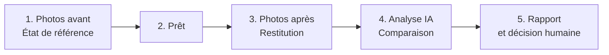
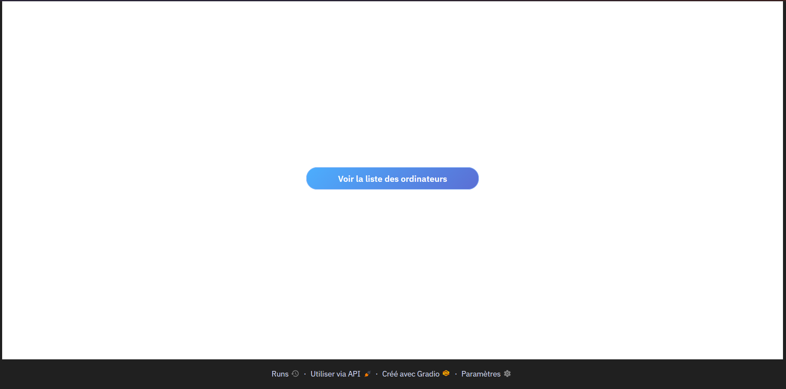
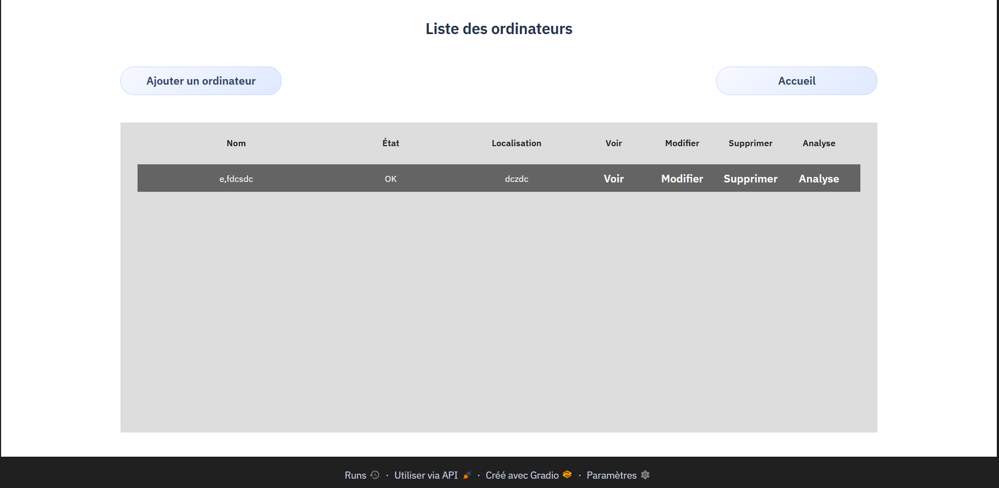
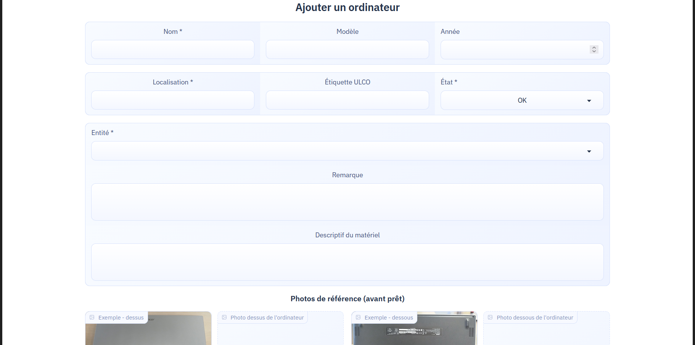
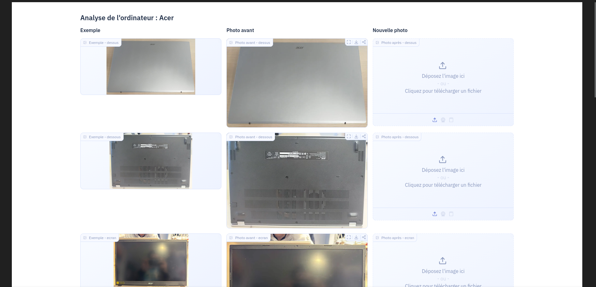
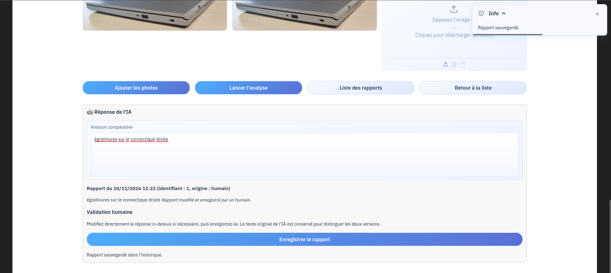

# Guide utilisateur

## Suivi de prêt d'ordinateurs avec analyse visuelle par IA

> **Objectif :** enregistrer l'état d'un ordinateur avant le prêt, comparer
> son état lors de la restitution et conserver la décision du gestionnaire.

  <strong>📸 État avant</strong>
  &nbsp;→&nbsp;
  <strong>🤖 Comparaison</strong>
  &nbsp;→&nbsp;
  <strong>✅ Décision du gestionnaire</strong>

## Sommaire

- [Démarrage en 5 minutes](#démarrage-en-5-minutes)
- [Comprendre le fonctionnement](#comprendre-le-fonctionnement)
- [Utiliser l'application](#utiliser-lapplication)
  - [Ouvrir l'application](#1-ouvrir-lapplication)
  - [Consulter le parc](#2-consulter-le-parc)
  - [Ajouter un ordinateur](#3-ajouter-un-ordinateur)
  - [Enregistrer une restitution](#4-enregistrer-une-restitution)
  - [Lancer et lire une analyse](#5-lancer-et-lire-une-analyse)
  - [Consulter l'historique](#6-consulter-lhistorique)
  - [Modifier une fiche](#7-modifier-une-fiche)
  - [Supprimer une fiche](#8-supprimer-une-fiche)
- [Prendre de bonnes photos](#prendre-de-bonnes-photos)
- [FAQ et résolution des problèmes](#faq-et-résolution-des-problèmes)

---

## Démarrage en 5 minutes

1. Ouvrez l'application à l'adresse fournie par l'administrateur
   (par défaut `http://localhost:7860`).
2. Cliquez sur **Voir la liste des ordinateurs**.
3. Ajoutez un ordinateur avec un **nom**, une **localisation** et une
   **entité**.
4. Ajoutez au moins une photo de référence, puis cliquez sur
   **Ajouter le matériel**.
5. À la restitution, ouvrez **Analyse**, ajoutez les photos après, puis
   cliquez sur **Lancer l'analyse**.
6. Vérifiez le résultat, corrigez-le si nécessaire et cliquez sur
   **Enregistrer le rapport**.

> [IMPORTANT]
> L'IA fournit une aide à l'inspection. Elle ne décide pas à la place du
> gestionnaire : vérifiez toujours les photos et le rapport avant de valider.

---

## Comprendre le fonctionnement

Les photos sont associées à une zone de l'ordinateur :

| Zone affichée | Vue à photographier |
| --- | --- |
| `dessus` | Capot supérieur |
| `dessous` | Coque inférieure et patins |
| `ecran` | Dalle et bordures de l'écran |
| `clavier` | Touches et pavé tactile |
| `connectique_gauche` | Ports situés à gauche |
| `connectique_droite` | Ports situés à droite |

Une comparaison n'est réalisée que lorsqu'une photo **avant** et une photo
**après** existent pour la même zone.

---

## Utiliser l'application

### 1. Ouvrir l'application

1. Ouvrez Chrome, Firefox ou Edge.
2. Saisissez l'adresse de l'application fournie par votre administrateur.
3. Cliquez sur **Voir la liste des ordinateurs**.

*La page d'accueil permet d'accéder à la liste des ordinateurs.*

### 2. Consulter le parc

La liste présente les informations principales de chaque ordinateur :

| Élément | Utilité |
| --- | --- |
| **Nom** | Identifier la machine |
| **État** | `OK`, `Réservé`, `En réparation`, `Endommagé` ou `Disparu` |
| **Localisation** | Indiquer où se trouve la machine |
| **Voir** | Ouvrir la fiche en lecture seule |
| **Modifier** | Corriger les informations ou remplacer des photos |
| **Supprimer** | Retirer définitivement la machine |
| **Analyse** | Ouvrir le parcours avant/après |

*La liste permet de consulter, modifier, supprimer ou analyser un ordinateur.*

### 3. Ajouter un ordinateur

Depuis la liste, cliquez sur **Ajouter un ordinateur** puis complétez le
formulaire :

- **Nom \*** : nom reconnaissable de la machine ;
- **Modèle** : marque et modèle ;
- **Année** : année d'acquisition, si elle est connue ;
- **Étiquette ULCO** : identifiant unique de l'inventaire ;
- **État \*** : généralement `OK` lors de l'enregistrement ;
- **Localisation \*** : salle, bureau ou zone de stockage ;
- **Entité \*** : entité propriétaire du matériel ;
- **Descriptif** et **Remarque** : informations complémentaires.

Ajoutez ensuite les photos de référence disponibles. Les six zones sont
proposées, mais une photo manquante empêchera seulement la comparaison de la
zone concernée.

Cliquez sur **Ajouter le matériel**.

> [ATTENTION]
> Le nom, la localisation et l'entité sont obligatoires. Une étiquette ULCO
> déjà utilisée est refusée car elle doit rester unique.

### 4. Enregistrer une restitution

1. Dans la liste, cliquez sur **Analyse** pour l'ordinateur concerné.
2. Pour chaque zone, consultez la photo **avant** affichée à gauche.
3. Déposez la photo **après** prise lors de la restitution à droite.
4. Cliquez sur **Ajouter les photos**.

Les photos après sont enregistrées dans l'application. Elles ne sont pas
analysées tant que vous n'avez pas cliqué sur **Lancer l'analyse**.

> [ASTUCE]
> Photographiez l'ordinateur dans une position et une lumière aussi proches
> que possible de celles utilisées lors du prêt.

### 5. Lancer et lire une analyse

Cliquez sur **Lancer l'analyse**. Pour chaque paire de photos disponible,
l'application :

1. compare la photo avant avec la photo après ;
2. vérifie le résultat avant de l'afficher ;
3. affiche les anomalies détectées ;
4. met en évidence les zones concernées sur les photos après.

Le rapport peut indiquer :

- la zone et l'élément concernés ;
- le type d'anomalie : rayure, fissure, tâche, choc, etc. ;
- la gravité : aucune, légère, marquée ou importante ;
- la zone de la photo où l'anomalie a été repérée.

Si une paire n'existe pas, le message **Aucune photo commune trouvée pour ce
matériel** est affiché.

> [IMPORTANT]
> Si l'analyse ne peut pas aboutir, un message vous l'indique. Vérifiez que
> les photos sont bien présentes et demandez de l'aide à l'administrateur si
> le problème persiste.

### 6. Consulter l'historique

Après une analyse :

1. vérifiez le texte affiché dans **Réponse de l'analyse** ;
2. corrigez le texte directement si nécessaire ;
3. cliquez sur **Enregistrer le rapport** ;
4. cliquez sur **Liste des rapports** pour afficher l'historique.

Chaque rapport conserve son origine :

- `ia` : texte enregistré sans modification ;
- `humain` : texte modifié par le gestionnaire.

L'historique affiche également les décisions et remarques ajoutées par les
gestionnaires.

### 7. Modifier une fiche

1. Dans la liste, cliquez sur **Modifier**.
2. Les informations existantes sont préremplies.
3. Modifiez les champs nécessaires.
4. Laissez les champs photo vides pour conserver les photos actuelles.
5. Déposez une nouvelle photo uniquement pour remplacer celle d'une zone.
6. Cliquez sur **Enregistrer les modifications**.

### 8. Supprimer une fiche

1. Cliquez sur **Supprimer**.
2. Cliquez une deuxième fois sur **Confirmer ?** pour confirmer.

La suppression retire la fiche et les données associées. Si le premier clic
était accidentel, ne confirmez pas.

---

## Prendre de bonnes photos

| À faire ✅ | À éviter ❌ |
| --- | --- |
| Poser l'ordinateur sur une surface stable | Photographier l'appareil à bout de bras |
| Cadrer toute la zone | Couper un bord ou un connecteur |
| Garder une distance et un angle réguliers | Changer fortement de perspective |
| Utiliser une lumière diffuse | Utiliser un flash créant des reflets |
| Nettoyer l'écran et la coque | Laisser poussière ou traces de doigts |

Pour chaque zone, essayez de conserver le même cadrage entre la photo avant et
la photo après. Les images sont adaptées automatiquement avant leur enregistrement.

Les images d'exemple servent de repères et ne sont jamais enregistrées à la
place des photos fournies par le gestionnaire.

---

## FAQ et résolution des problèmes

<strong>Quels formats d'image puis-je utiliser ?</strong>

Les formats d'image courants, comme JPG et PNG, sont acceptés. Les images sont
adaptées automatiquement avant leur enregistrement.

<strong>Pourquoi mon ordinateur ne peut-il pas être enregistré ?</strong>

Vérifiez les champs obligatoires : nom, localisation et entité. Vérifiez aussi
que l'étiquette ULCO n'est pas déjà associée à un autre ordinateur.

<strong>Pourquoi aucune anomalie n'est-elle affichée ?</strong>

Vérifiez qu'une photo avant et une photo après existent pour la même zone.
Vérifiez également que le service d'analyse est disponible. Si le problème
persiste, demandez de l'aide à l'administrateur.

<strong>L'IA a-t-elle toujours raison ?</strong>

Non. Un reflet, une poussière ou un changement d'angle peut produire un faux
positif. Comparez les photos vous-même et utilisez la validation humaine pour
conserver la décision réellement retenue.

<strong>Comment conserver les photos existantes lors d'une modification ?</strong>

Laissez les champs photo vides dans le formulaire de modification. Seules les
zones pour lesquelles vous fournissez une nouvelle photo sont remplacées.

<strong>Que faire si l'analyse ne fonctionne pas ?</strong>

Vérifiez que les photos avant et après sont bien présentes pour la même zone.
Si le problème persiste, transmettez le message affiché à l'administrateur.
Les photos et les rapports déjà enregistrés restent conservés.

---

## Besoin d'aide ?

Avant de signaler un problème, notez :

1. le nom de l'ordinateur ;
2. la zone analysée ;
3. l'action effectuée ;
4. le message affiché ;
5. l'heure approximative du problème.

Ces informations permettent à l'administrateur de comprendre rapidement le
problème.
