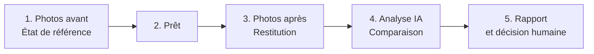

# Comprendre le fonctionnement

## Le cycle d'un prêt

## Les zones photographiées

Les photos sont associées à une zone de l'ordinateur :

| Zone affichée | Vue à photographier |
| --- | --- |
| `dessus` | Capot supérieur |
| `dessous` | Coque inférieure et patins |
| `ecran` | Dalle et bordures de l'écran |
| `clavier` | Touches et pavé tactile |
| `connectique_gauche` | Ports situés à gauche |
| `connectique_droite` | Ports situés à droite |

!!! info "Règle de comparaison"
    Une comparaison n'est réalisée que lorsqu'une photo **avant** et une photo
    **après** existent pour la même zone.

Pour obtenir des comparaisons fiables, consultez
[Prendre de bonnes photos](bonnes-photos.md).
