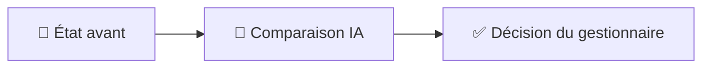

# Guide utilisateur

**Suivi de prêt d'ordinateurs avec analyse visuelle par IA**

Cette application permet d'enregistrer l'état d'un ordinateur avant son prêt,
de comparer son état lors de la restitution et de conserver la décision du
gestionnaire.

!!! warning "L'IA est une aide, pas un juge"
    L'IA fournit une aide à l'inspection. Elle ne décide pas à la place du
    gestionnaire : vérifiez toujours les photos et le rapport avant de valider.

## Par où commencer ?

| Vous voulez… | Page à consulter |
| --- | --- |
| Prendre l'application en main rapidement | [Démarrage en 5 minutes](demarrage-rapide.md) |
| Comprendre le principe avant/après | [Comprendre le fonctionnement](fonctionnement.md) |
| Ajouter un ordinateur au parc | [Ajouter un ordinateur](utilisation/ajouter-ordinateur.md) |
| Enregistrer un retour de prêt | [Enregistrer une restitution](utilisation/restitution.md) |
| Interpréter un rapport d'analyse | [Lancer et lire une analyse](utilisation/analyse.md) |
| Obtenir des comparaisons fiables | [Prendre de bonnes photos](bonnes-photos.md) |
| Résoudre un problème | [FAQ et dépannage](faq.md) |

## Contenu du guide

- **Prise en main** : [démarrage rapide](demarrage-rapide.md) et
  [principe de fonctionnement](fonctionnement.md).
- **Utiliser l'application** : de l'[ouverture](utilisation/ouvrir.md) à la
  [suppression d'une fiche](utilisation/modifier-supprimer.md), étape par étape.
- **Bonnes pratiques** : [conseils de prise de vue](bonnes-photos.md).
- **Aide** : [questions fréquentes et contact](faq.md).
