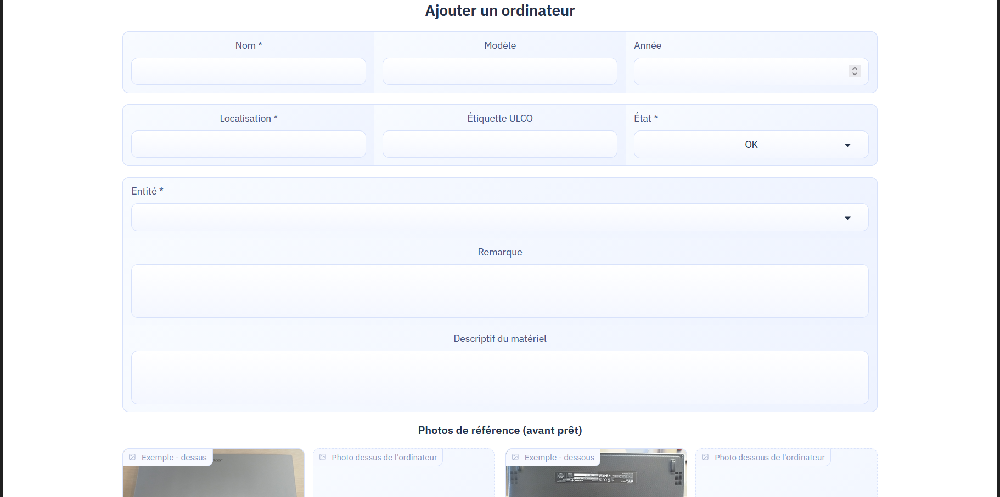

# Ajouter un ordinateur

Depuis la liste, cliquez sur **Ajouter un ordinateur** puis complétez le
formulaire.

## Champs du formulaire

| Champ | Obligatoire | Contenu attendu |
| --- | :---: | --- |
| **Nom** | ✅ | Nom reconnaissable de la machine |
| **Modèle** | | Marque et modèle |
| **Année** | | Année d'acquisition, si elle est connue |
| **Étiquette ULCO** | | Identifiant unique de l'inventaire |
| **État** | ✅ | Généralement `OK` lors de l'enregistrement |
| **Localisation** | ✅ | Salle, bureau ou zone de stockage |
| **Entité** | ✅ | Entité propriétaire du matériel |
| **Descriptif** / **Remarque** | | Informations complémentaires |

## Photos de référence

Ajoutez ensuite les photos de référence disponibles. Les six
[zones](../fonctionnement.md#les-zones-photographiees) sont proposées, mais une
photo manquante empêchera seulement la comparaison de la zone concernée.

Cliquez sur **Ajouter le matériel**.

<figure markdown="span">
  
  <figcaption>Formulaire d'ajout d'un ordinateur et de ses photos de référence.</figcaption>
</figure>

!!! danger "Attention"
    Le nom, la localisation et l'entité sont obligatoires. Une étiquette ULCO
    déjà utilisée est refusée car elle doit rester unique.

**Étape suivante :** [Enregistrer une restitution](restitution.md)
