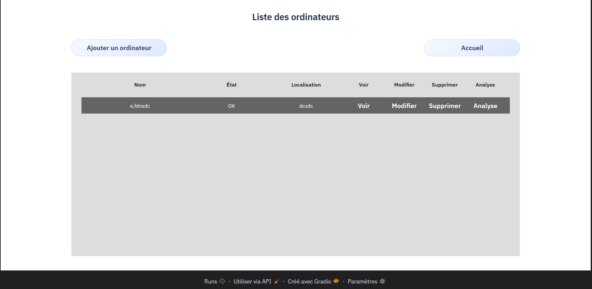

# Consulter le parc

La liste présente les informations principales de chaque ordinateur :

| Élément | Utilité |
| --- | --- |
| **Nom** | Identifier la machine |
| **État** | `OK`, `Réservé`, `En réparation`, `Endommagé` ou `Disparu` |
| **Localisation** | Indiquer où se trouve la machine |
| **Voir** | Ouvrir la fiche en lecture seule |
| **Modifier** | Corriger les informations ou remplacer des photos — voir [Modifier ou supprimer une fiche](modifier-supprimer.md) |
| **Supprimer** | Retirer définitivement la machine |
| **Analyse** | Ouvrir le parcours avant/après — voir [Enregistrer une restitution](restitution.md) |

<figure markdown="span">
  
  <figcaption>La liste permet de consulter, modifier, supprimer ou analyser un ordinateur.</figcaption>
</figure>

**Étape suivante :** [Ajouter un ordinateur](ajouter-ordinateur.md)
