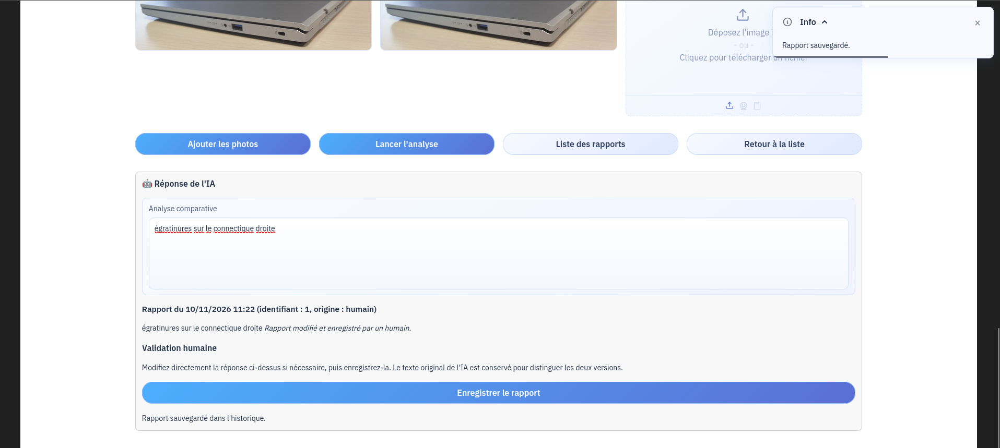

# Enregistrer le rapport et consulter l'historique

Après une [analyse](analyse.md) :

1. vérifiez le texte affiché dans **Réponse de l'analyse** ;
2. corrigez le texte directement si nécessaire ;
3. cliquez sur **Enregistrer le rapport** ;
4. cliquez sur **Liste des rapports** pour afficher l'historique.

## Origine des rapports

Chaque rapport conserve son origine :

| Origine | Signification |
| --- | --- |
| `ia` | Texte enregistré sans modification |
| `humain` | Texte modifié par le gestionnaire |

L'historique affiche également les décisions et remarques ajoutées par les
gestionnaires.

<figure markdown="span">
  
  <figcaption>Historique des rapports et des décisions d'un ordinateur.</figcaption>
</figure>

**Étape suivante :** [Modifier ou supprimer une fiche](modifier-supprimer.md)
