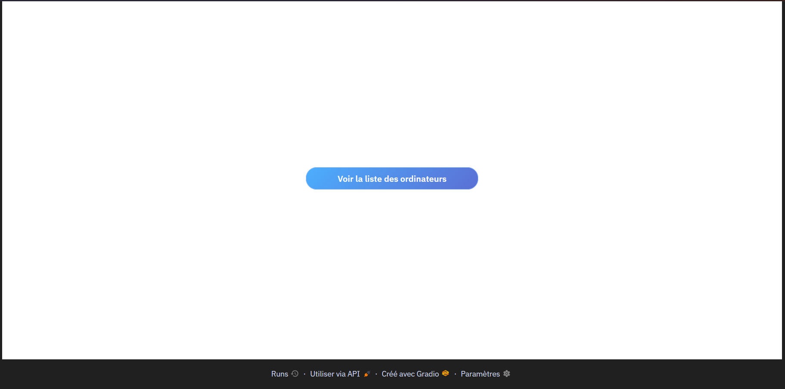

# Ouvrir l'application

1. Ouvrez Chrome, Firefox ou Edge.
2. Saisissez l'adresse de l'application fournie par votre administrateur
   (par défaut `http://localhost:7860`).
3. Cliquez sur **Voir la liste des ordinateurs**.

<figure markdown="span">
  
  <figcaption>La page d'accueil permet d'accéder à la liste des ordinateurs.</figcaption>
</figure>

**Étape suivante :** [Consulter le parc](consulter-parc.md)
