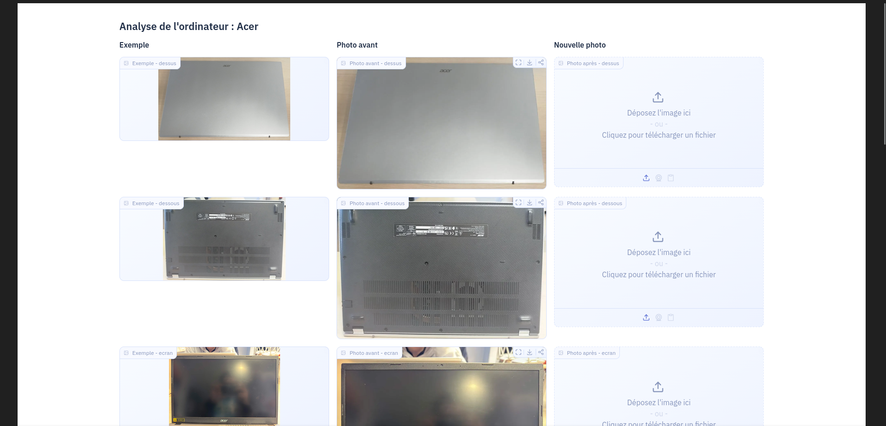

# Enregistrer une restitution

1. Dans la liste, cliquez sur **Analyse** pour l'ordinateur concerné.
2. Pour chaque zone, consultez la photo **avant** affichée à gauche.
3. Déposez la photo **après** prise lors de la restitution à droite.
4. Cliquez sur **Ajouter les photos**.

Les photos après sont enregistrées dans l'application. Elles ne sont pas
analysées tant que vous n'avez pas cliqué sur **Lancer l'analyse**.

!!! tip "Astuce"
    Photographiez l'ordinateur dans une position et une lumière aussi proches
    que possible de celles utilisées lors du prêt. Voir
    [Prendre de bonnes photos](../bonnes-photos.md).

<figure markdown="span">
  
  <figcaption>Photos avant (à gauche) et après (à droite) pour chaque zone.</figcaption>
</figure>

**Étape suivante :** [Lancer et lire une analyse](analyse.md)
